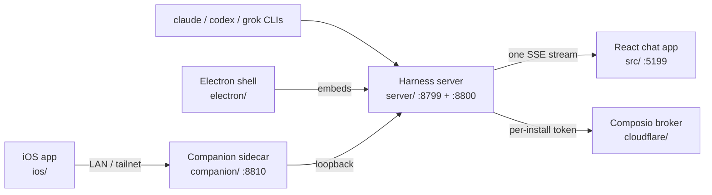

# OpenMausBot

A local-first desktop chat application for running a team of AI agents. Every chat
in the sidebar is a real agent process (the `claude`, `codex`, or `grok` CLI) running
on the user's own machine. One harness server on `127.0.0.1:8799` owns every agent
process and normalizes each provider's native protocol into a single SSE event stream;
the React app holds no transports of its own and only folds that stream into state.

This checkout is Milad's private fork. `origin` is `mimen/OpenMausBot`, `upstream` is
`milind-soni/OpenMausBot`. Upstream is an independent Apache-2.0 reimplementation of
xAI's Grok Bot by Milind Soni, which began life as OpenGrokBot (the `OGB_` env prefix
survives from that name). **It is not a fork of CopilotKit's OpenBot.** That is an
unrelated MIT, Bun-based project living in a separate checkout at `Repos/openbot` with
zero shared history. An earlier inventory collapsed the two into one description; they
are different repositories and this record supersedes that framing.

## Components

Nine, not the four an earlier inventory recorded. Two exist only in the fork, and one
of those two exists only as uncommitted files.

| Component | Path | What it is | Surfaces |
|---|---|---|---|
| React chat app | `src/` | Vite, React 19, Tailwind 4 renderer. No client transports; sends HTTP, folds one SSE stream. | web |
| Harness server | `server/` | Plain-Node HTTP and SSE on `127.0.0.1:8799`, owns every agent process. Webhook receiver on `:8800`. No framework, by policy. | api, resident |
| Electron desktop shell | `electron/` | macOS, Windows, Ubuntu shells embedding the harness server. The signed download. | desktop |
| Companion sidecar | `companion/` | Node proxy on `:8810` fronting the loopback harness so a phone can reach it without the harness leaving `127.0.0.1`. | resident, api |
| iOS companion app | `ios/` | Dependency-free SwiftUI client for the same harness, reached through the sidecar. | mobile |
| Cloudflare Composio broker | `cloudflare/composio-broker/` | Worker keeping the shared Composio key out of desktop builds; mints per-install sessions. | api, backend-data |
| oxlint anti-slop plugin | `tools/oxlint/anti-slop/` | 16 custom lint rules encoding type-system discipline as lints instead of prose. | library |
| Generative UI component pack | `server/ui/`, `src/components/ui/` | Fork only (`origin/main`). Structured components an agent emits and the chat renders natively instead of markdown. | library |
| Local deployment system | `scripts/deployment/`, `DEPLOY.md` | Fork only, uncommitted. Installs and verifies a signed local production build at `/Applications/OpenMausBot.app`. | cli-tui |

## How they relate

The harness server is the center. Everything reaches an agent process through it, and
the renderer never contacts an external system on its own. The sidecar exists so a
phone can talk to the harness without the harness ever unbinding from loopback. The
Cloudflare broker is the one component that is not launched locally.

## What the components share

**The repository is in three states, and which one you read changes everything.** Local
`main` (`6b2ca7e`) is pure upstream code, zero fork commits, 172 commits behind
`upstream/main`, with no local commit on it. `origin/main` (`3e3c00d`) is the fork: 17
commits by Milad, and the branch to work from. A third state is a worktree with
uncommitted work described next.

**The entire local deployment system exists only as uncommitted files.** `DEPLOY.md`,
`scripts/deployment/` (nine modules and eight colocated tests), `scripts/dev.mjs`, and
`shared/release-identity.mjs` live as 31 uncommitted entries in the
`.claude/worktrees/openmaus-local-deployment` worktree. None of it is in any commit, on
any branch, or on any remote. `origin/main`'s `package.json` defines no `deploy:*`
scripts, so every command `DEPLOY.md` documents is unreachable from a clone. This
exposure is tracked as issue #9 in `mimen/claude-config`, because this repository has
issues disabled.

**Shared runtime state and ports.** All components read and write `~/.openmausbot/`
(bots, transcripts, per-thread NDJSON logs, `config.json`). The dev app and harness
default to fixed ports 5199 and 8799, so two worktrees running `pnpm dev` collide; the
uncommitted deployment system's `scripts/dev.mjs` is the fix, derived per worktree.
API keys live server-side and the UI only ever sees `configured` booleans.

## Operating notes that span components

Work from `origin/main`, not the checked-out `main`, which contains none of the fork
work and is 172 commits behind upstream. Fork development happens on
`feat/local-deployment-system`, whose tip equals `origin/main`.

**Do not clean, reset, or checkout in `.claude/worktrees/openmaus-local-deployment`.**
31 paths are uncommitted there and 15 of them exist nowhere else. It is deliberate
mid-flight work with one copy on one disk, not debris.

Verification loop: `pnpm typecheck && pnpm test` covers roughly 1091 tests behind a
count-floor guard. `node scripts/e2e-server.mjs` drives the real harness API.
`swift test --package-path ios` covers the iOS core.

## Repo-level gaps

No agent entry file (`AGENTS.md`, `CLAUDE.md`, `STANDARDS.md`) is tracked on either
branch, so nothing routes a cold agent to the architecture. CI runs typecheck and
tests across three OSes but never runs `pnpm lint`, so the 16-rule anti-slop plugin
cannot fail a PR. The strongest deployment document in the repository, `DEPLOY.md`,
documents commands no clone can run; see issue #9.
